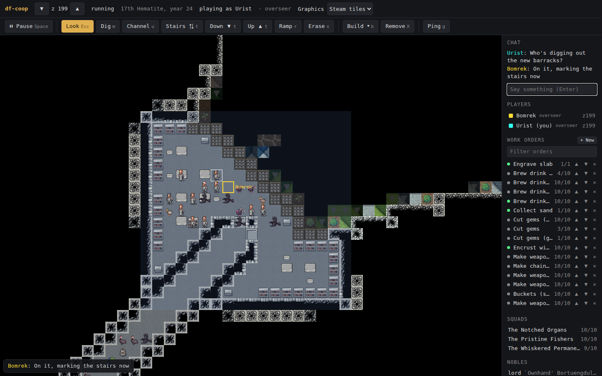
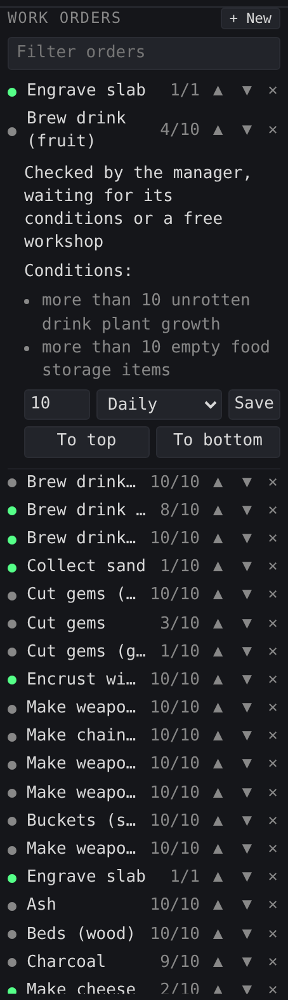
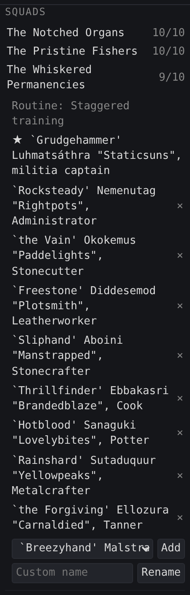
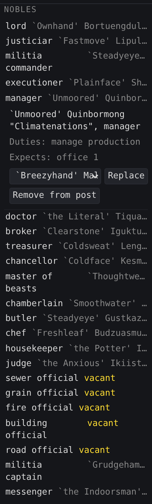
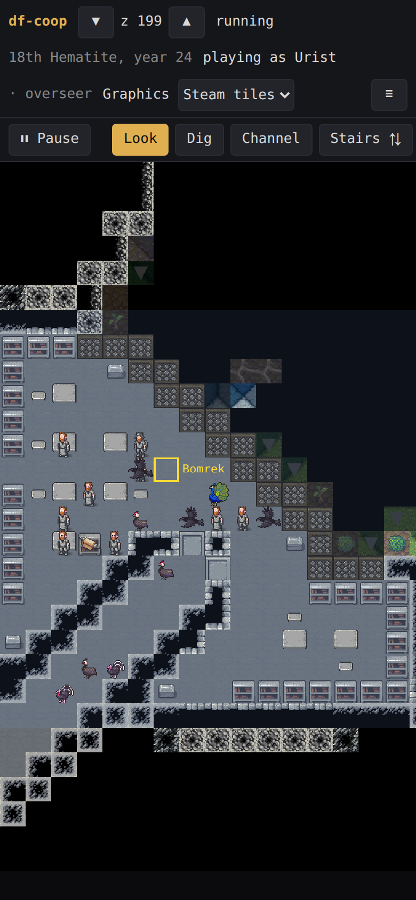
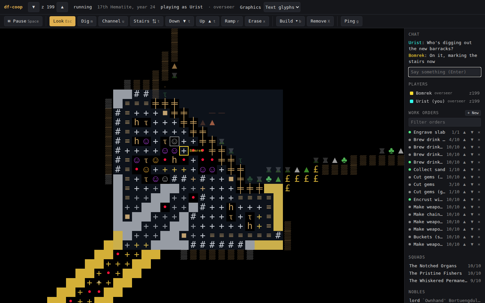

# df-coop

Multiplayer Dwarf Fortress: several people running one fortress together, each from their own browser.



Dwarf Fortress has no networking, and dfplex, the old multiplayer plugin, stopped working when the Steam release (v50) rewrote the interface. df-coop doesn't try to share DF's own screen. DF runs on one machine, the host. A hub on that machine reads the fortress through DFHack and sends it to every player. Players act through their own client, and the hub carries out their actions with DFHack. The host is the only authority, and every action is logged with the player who made it.

```
 browser ──┐                                   ┌── RemoteFortressReader (map, units, dig, pause)
 browser ──┼── websocket ── hub (Python) ── DFHack RPC :5000 ──┤
 browser ──┘                                   └── RunLua rpc.coop (build, zones, orders, squads)
```

DFHack's RPC port stays bound to localhost. Players only connect to the hub.

## Screenshots

Work orders, squads and nobles, all managed from the side panel:

<p>
  
  
  
</p>

It also works on a phone, and text glyphs are available if you prefer the classic look:

<p>
  
  
</p>

## Status

Players open a link, watch the fortress live, see each other's cursors, dig together (every designation coloured by the player who placed it) build together (furniture, workshops, constructions, farm plots, stockpiles and zones), run the work order queue, inspect creatures and follow DF's announcements. Anyone can pause; the game resumes when everyone who paused is ready.

## Experimental: back up your saves

This reads and changes a live fortress through DFHack. Several panels write directly to DF's records where DFHack has no call for the job: noble appointments, squad station and kill orders, work order conditions, work details (which also set each dwarf's labors), workshop tasks and farm crops. Those changes are saved into the fort. Each was tried on a disposable copy of a fort through game time, and most through a save and reload as well, but keep backups and try new features on a copy of a save first.

## Requirements

- Dwarf Fortress (Steam, v50+) with DFHack 53.16-r3. The bundled protobuf definitions are from that tag.
- Python 3.10+ and its dependencies: `pip install -r requirements.txt`

## Running it

Load a fortress in DF, then:

```bash
python3 hub.py install-lua                # once: puts rpc/coop.lua into DFHack (needed for building)
python3 hub.py add-player YOURNAME        # prints your join link
python3 hub.py serve                      # http://127.0.0.1:8765/
```

`install-lua` copies `lua/rpc/coop.lua` into DF's `hack/lua/rpc/` (set `DF_DIR` if DF isn't in the default Steam location). A DFHack update can remove it; the hub then says so and runs with building switched off, and turns it back on by itself once you reinstall.

Open the printed link. Each friend needs their own `add-player NAME`, optionally with a role:

| Role | May |
|---|---|
| overseer (default) | everything |
| builder | dig, build, remove, pause, chat |
| miner | dig, pause, chat |
| quartermaster | work orders, work details, pause, chat |
| commander | squads, pause, chat |
| visitor | watch, chat and ping |

`python3 hub.py set-role NAME ROLE` changes a role; a running hub applies it within a few seconds, without anyone reconnecting. Players added before roles existed are overseers. Tokens are stored in `~/.config/df-coop/players.json` (mode 600), outside the repo.

`serve` listens on localhost by default. To let friends in from anywhere, put an HTTPS tunnel in front of it. Tailscale Funnel works behind NAT, is free, and only the host installs anything:

```bash
tailscale funnel --bg http://127.0.0.1:8765     # https://<machine>.<tailnet>.ts.net
```

Friends then open `https://<machine>.<tailnet>.ts.net/?token=<their token>`. Don't forward the hub's port directly: without a tunnel it speaks plain HTTP, and the token would cross the internet unencrypted. On a network you trust, `serve --host <LAN address>` is fine.

New players added with `add-player` can join without restarting the hub.

To check the DFHack connection on its own:

```bash
python3 dfhack_rpc.py            # versions, map size, pause state, unit count
```

### In the browser

Keys follow Steam Dwarf Fortress's defaults (`data/init/interface.txt`), so DF players don't have to relearn them.

| Key | Does | In DF |
|---|---|---|
| `W A S D`, arrows, drag | move (Shift: faster) | same |
| `e` / `c`, `<` / `>`, mouse wheel | up / down a level | same |
| `[` / `]`, Ctrl + wheel, pinch | zoom | `[` `]` |
| `Space` | pause; resumes when everyone who paused is ready | pause |
| `m`, then `m` `u` `t` `r` | dig, channel, stairs (`t` again: down, then up stairs), ramp | dig menu |
| `p` / `P` in the dig menu, or the − + buttons | designation priority: 1 is done first, 7 last (default 4) | same |
| `x` | erase designations | same |
| `b`, then DF's menu letters | build: the same pages and letters as DF's build menu, e.g. `b o f p` farm plot, `b p r` door, `b o u l` smelter | same |
| `p` / `z` | stockpiles / zones | same |
| `o` | work orders | same |
| `q` | squads | same |
| `n` | nobles | same |
| `N` | announcements | same |
| `Enter` | select at the cursor while a tool is active; open chat in Look | select |
| `Esc`, right-click | back / cancel (leaves a text box, steps out of the build menu) | back |
| `X` (Shift+x) | remove a building, stockpile or zone | (no key in DF) |
| `g` | ping the tile under the cursor | (no key in DF) |
| Click / tap | place, pick corners, inspect a creature | |

Designations take two corners (clicks, taps, or `Enter` at each corner). Workshops centre on the click. On phones, the ▼ ▲ buttons change level and ☰ opens the side panel.

Designations carry DF's priority (1 first, 7 last). Tiles show their number when it isn't the default 4, and the hover says who placed them and at what priority. Priority updates require in-game module v7: run `python3 hub.py install-lua` after upgrading. Older modules still allow default-priority digging, but do not receive priority updates; DF may retain an old priority on a re-designated tile.

The hub only applies a designation where DF would accept it (rock for digging, floors for channels and down stairs, never constructions, trees or open air) and tells you how many tiles were skipped. Unexplored tiles take any designation, as in DF.

The Citizens panel (`u`) lists everyone in the fort with their job, mood and squad, with a filter and sorting by unhappiest or idle. Click someone to go to them and open their details. DF is only asked while the panel is open. It needs in-game module v14: run `python3 hub.py install-lua` after upgrading.

The Work details panel (`l`) shows who does what, counting only the living, and flags a detail nobody is on. Pick people with tick boxes, or set it to everybody or nobody. Dwarves can't be given two tool labors (mining, woodcutting, hunting). Changes take effect at once, without opening DF's screen. It needs in-game module v15.

The Stocks panel (`k`) counts what the fort has by material and kind ("granite blocks", "silver short swords", "hen eggs") under headings such as raw materials and food, with a filter. Anyone can look. It is our own count, not DF's Stocks screen: it leaves out traders' goods, webs, items built into something or carried by outsiders, and anything in places nobody has explored. Counting holds DF for about half a second on a large fort, so the hub counts only while someone has the panel open, at most once a minute, and shares the count. It needs in-game module v17.

The Work orders panel follows DF's manager queue. A dot shows each order's state (green active, grey checked by the manager, yellow waiting for the manager). Queue new orders once or on a repeat, move them with ▲ ▼, and click an order to change its amount or repeat, or send it to the top or bottom. Saving a new amount restarts the count. Editing needs in-game module v8: run `python3 hub.py install-lua` after upgrading.

The same details change an order's conditions: edit the comparison and number on any item condition, remove any condition, add an item count ("at least 10 logs", by item type only), or make it wait until another order is activated or completed. Orders can't be set to wait for each other in a loop. You can also limit how many workshops work on an order at once. These need in-game module v13.

The Squads panel (`q`) lists the fort's squads with their members, routine and orders. Click a squad to add an adult citizen to an open slot, remove a member, or give it a custom name (clear the box to restore the generated one). The leader (★) comes with a noble position and stays, and members away from the fort can't be removed. As in DF, leaving a squad goes on that dwarf's history. Creating squads and changing routines aren't here yet. Squads need in-game module v9.

An open squad also takes orders. **Station** sends it to a tile you pick on the map, and **Kill** sends it after an enemy in sight, or all of them. Kill orders can only name enemies, never citizens or friends. A new order replaces the squad's current station or kill order, and **Cancel orders** sends it back to its routine. Orders need the `military` permission and in-game module v12.

The Nobles panel (`n`) lists the fort's posts in order of rank, with who holds each, their duties and the rooms and furniture the post expects. Click a post to appoint someone, replace the holder, or remove them; one dwarf may hold several posts, as in DF. Posts that lead a squad, inherited titles and posts DF fills itself are shown but can't be changed here, and the panel says why. Each change goes on the fort's history, and only overseers may make them. Nobles need in-game module v10.

Click a stockpile or zone on the map in Look mode to see it in the side panel; if several overlap, click again for the next. A stockpile lets you switch its categories on and off, set how many barrels, bins and wheelbarrows it may use, and name it. Switching a category uses DFHack's own presets, so it covers everything in that category and replaces any finer choices made in DF. A zone shows whether it's active, and bedrooms, offices, dining rooms and tombs can be assigned to a dwarf or freed. Builders and overseers can change these; everyone can look. These need in-game module v11.

Click a workshop or furnace the same way to see its tasks: who is working on each, whether it's suspended, set to repeat or marked do now, and which work order it came from. Work order managers (quartermasters and overseers) can suspend, resume, prioritise, repeat or cancel a task, and assign one dwarf as the only one allowed to work there. The panel checks again every few seconds while it's open. New tasks still go through Work orders. This needs in-game module v16.

Click a farm plot to pick its crop for each season, or leave it fallow. Only crops that grow there in that season are offered, by the same rule DFHack's autofarm uses, each with how many seeds the fort has; a crop with no seeds can be picked but nothing gets planted until seeds turn up. There is also DF's switch to fertilize each season. Builders and overseers can change these; everyone can look. If DFHack's autofarm is on, it picks crops for every plot itself and will replace choices made here or in DF; the panel says so, and the host can turn it off with `disable autofarm`. This needs in-game module v18.

On a computer, drag the side panel's left edge to resize it, or double-click the edge to reset it. Your browser remembers the width.

Every order is logged with the player's name in `~/.local/share/df-coop/<world>-<location>.actions.jsonl` (named after the fort's world and position, so DF's autosaves don't split it). Players who come back after five minutes or more get a "while you were away" summary: how much game time passed, what each other player did, and the announcements they missed.

New dig log entries record the exact applied tiles as compact spans, so skipped tiles keep their original owner after a restart. Priority changes use those same spans in one Lua call, leaving existing orders on skipped tiles alone. Old logs still load using their recorded rectangles; missing historical tile details cannot be recovered.

Use **Graphics** in the top bar to switch between **Text glyphs** and **Steam tiles**. The choice is saved in each browser. Steam mode draws terrain, directional walls/ramps, furniture, workshop/furnace layouts, machinery, stockpiles, shrubs, saplings, tree trunks/branches, loose ground items and flows such as smoke, fire and miasma. Animals use species/caste sprites; dwarves and other humanoids use layered bodies and clothing selected from their equipment. Large creature sprites and workshop overhangs retain their native proportions, and sprites stay clipped to explored tiles.

The hub reads assets directly from the environment, items, buildings, plants and creatures graphics packages under `DF_DIR/data/vanilla` (the default Steam install is detected); no game images are copied into this repository. Set `DF_DIR` before starting the hub for another installation. Images load on demand and repeated creature/equipment combinations share cached layer selection. Creature raw definitions are fetched in bounded requests only while Steam viewers need them. Missing graphics disable the Steam option; missing or unsupported individual graphics fall back to text. Restart the hub after installing or changing assets, then refresh the browser.

This uses the game's sprites with representative appearance variants, rather than reproducing every rule in its renderer. Exact material/skin/clothing palettes, individual hairstyles, injuries, building construction/open/active states, species-specific vegetation and procedural/mod graphics remain incomplete. Unsupported buildings and creatures retain glyphs; spatter is not drawn. Item and flow removal uses complete polled-level snapshots, so the last object disappearing from a block clears it without resetting DFHack's terrain hashes or making another game RPC.

Open space shows the level below, dimmed. Unexplored tiles are black, and so are the creatures and buildings on them. Ambushers DF is hiding are left out too. Designation colours and priority numbers remain visible in either graphics mode.

Polling combines adjacent subscribed levels in groups of at most two, keeping first reads separate from cached levels. Players watching the same levels share unit filtering and serialization, and building updates are sent once per polling pass. These reduce RPC and hub overhead; measure live FPS before claiming a particular improvement.

## Layout

| Path | What |
|---|---|
| `hub.py` | The hub: serves the client, authenticates players, polls the levels players are viewing, fans out changes |
| `mapstate.py` | The hub's copy of the fortress; merges partial terrain updates, tracks item/flow snapshots and removes anything hidden |
| `rpcstats.py` | Times the hub's calls to DF; the hub logs a summary once a minute |
| `tiles.py` | Tiletype to glyph and colour |
| `game_tiles.py` | Installed-game sprite discovery, building layouts, creature layers and allowlisted image pages |
| `actions.py` | What can be dug where, roles, rate limiting, the action log, who designated what |
| `away.py` | When each player left, and the summary of what they missed |
| `catalog.py` | Everything players can build (quickfort keys) or order (job and reaction names); the game calendar |
| `buildmenu.py` | DF's build menu (pages, letters, buildings), generated by `tools/gen_build_menu.py` |
| `tools/bench.py` | A disposable second DF on its own folder, save, port and display, for scenarios that need real game time |
| `tools/` | `watch_build_menu.py` captures DF's build menu while you browse it in DF; `gen_build_menu.py` turns that into `buildmenu.py` |
| `lua/rpc/coop.lua` | The in-game module: places and removes buildings, stockpiles and zones (quickfort), sets designation priority, lists, queues, edits, reorders and cancels work orders, manages squad members and names, appoints nobles, changes stockpile and zone settings, reads announcements and creature details, reports the date |
| `static/` | The browser client (`index.html`, `client.js`), no build step |
| `dfhack_rpc.py` | DFHack remote-protocol client: handshake, method binding, text and failure replies, RemoteFortressReader helpers, `run_lua` |
| `proto/` | DFHack's `.proto` files and the generated `*_pb2.py`; `regen.sh` rebuilds them |
| `test_*.py` | RPC client against a fake DFHack server; map cache and visibility; digging rules; hub over real websockets with a fake fortress (joining, digging, ownership, pausing) |

## Tests

```bash
pytest df-coop
```

`test_game_tiles.py` covers asset discovery, building layouts, creature/caste/clothing selection, fallback and the HTTP file boundary. Optional desktop/mobile browser tests in `test_client_browser.py` run when Playwright and Chromium are installed (`pip install playwright`, then `playwright install chromium`); otherwise they skip. They use synthetic images and never connect to DF, checking switching, lazy image loading, building footprints, directional walls and fog clipping. Hub/map tests use a fake fortress, including batched polling, last-item/flow removal, hidden-tile checks and priority/ownership preservation on skipped tiles. `test_coop_lua.py` exercises the actual Lua span writer against a mocked map when a Lua interpreter is installed.

## Recommended next steps

1. Play one complete session with two or more people. Check conflicting designations, disconnecting while holding pause, role changes, reconnects and a native host playing alongside the browsers.
2. Measure DF FPS and hub RPC time with one, two and several viewers, especially on different levels. Next optimize map polling by viewport and consider adaptive polling; preserve first-read hash handling and hidden-tile filtering.
3. Improve Steam fidelity: exact material/appearance palettes, individual hair and injuries, building state, plant species and procedural/mod graphics. Keep the glyph fallback. The visual snapshot behavior follows the [pinned RemoteFortressReader implementation](https://github.com/DFHack/dfhack/blob/53.16-r3/plugins/remotefortressreader/remotefortressreader.cpp); preserve its complete-slice semantics when adding viewport subscriptions.
4. Add the management controls needed for a whole session: stockpile categories and zone/bedroom assignments, then squads and station/attack orders.

## License

MIT, see `LICENSE`. `proto/` holds DFHack's protobuf definitions, and `tools/quickfort_build.tsv` is derived from DFHack's quickfort; DFHack's license is in `proto/DFHACK-LICENSE.rst`. Not affiliated with Bay 12 Games or the DFHack project. No game files are included: graphics are read from your own installed copy. Screenshots show the Steam edition's graphics, which belong to their creators (Bay 12 Games and Kitfox Games).
